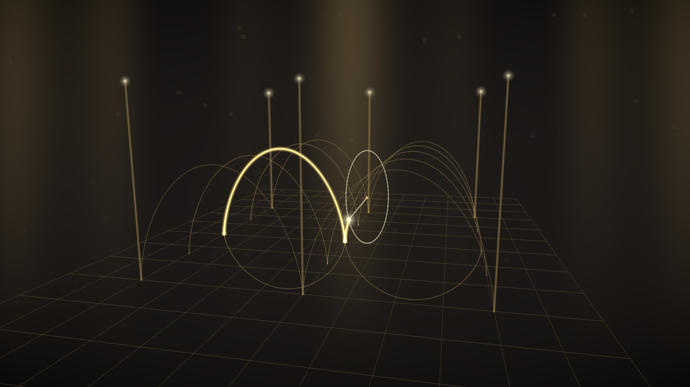

# Revelatio Noetica

*A Living Atlas of Mathematics and Natural Philosophy*

A GPU-first desktop engine for visualizing advanced mathematics and theoretical
physics with technical honesty: a native Rust + wgpu renderer, a plugin
architecture of concept modules, synchronized multi-pane representations, and
exact mathematics wherever exact mathematics is possible.

Not a graphing calculator. Not an animation toy. Every representation states
what it computes and how it approximates.



## Build & run

Requires Rust (`x86_64-pc-windows-gnullvm` toolchain on this machine, with
llvm-mingw on PATH):

```powershell
$env:RUSTFLAGS = "-C target-feature=+crt-static"
cargo +stable-x86_64-pc-windows-gnullvm build --release
.\target\release\revelatio.exe            # launch the atlas
```

Headless CLI (no window; used for export and CI):

```
revelatio --list                                        # modules & representations
revelatio --export <id|all> [--mode N] [--size WxH] [--t sec] [--out dir]
revelatio --frames <id> [--mode N] [--n 150] [--fps 30] [--out dir]
revelatio --scene <file.scene.json> [--size WxH] [--out png]
```

## The interface

- **Concept Browser** (left): the atlas, grouped by branch, each with its own
  luminous identity.
- **GPU Canvas** (center): 1–4 synchronized panes, one per active
  representation. Drag = orbit/pan · wheel = zoom · shift/right-drag = pan ·
  double-click = reset camera.
- **Symbolic Inspector** (right): the objects themselves — definitions,
  formulas in engraved notation, and live numeric values.
- **Representation Deck + Timeline** (bottom): toggle representations;
  play/pause/scrub the generating time `t`, set speed, span, loop mode.
- **Export**: 1080p / 4K stills, 240-frame video sequences (with an ffmpeg
  one-liner written alongside), and interactive `.scene.json` files that
  round-trip module, parameters, time, and open views.

## Typeset mathematics

Inspector formulas are genuine LaTeX: `assets/math/manifest.txt` holds the
sources, `tools/render_math.ps1` renders them through MiKTeX (latex + dvipng)
into transparent PNGs and regenerates `src/mathimg_gen.rs`, which bakes them
into the binary. Run the script after editing the manifest. Live numeric values
stay as text; the typeset formulas carry the theory.

## Interactivity

Views marked with a ✦ hint accept the pointer directly (camera moves via
shift-drag / right-drag there): strike the wave membrane, drag the Green's
probe, sculpt the matrix by its basis vectors, drag spacetime events past each
other, paint Ising spins, drop phase-space trajectories, drag the four charges
of the Field Forge, fire measurement bursts.

## The twenty-three chambers (91 representations)

The largest wing is **Differential Equations**: the Integrator's Workshop
(slope fields, Euler vs RK4, Van der Pol, Lotka–Volterra, resonance) and the
Field Equations Hall (heat, Laplace relaxation, Burgers shock, string
eigenmodes, Gray–Scott reaction–diffusion). Statistical mechanics carries the
Monte Carlo Casino (dartboard π, Buffon's needle, integration by rain).

| Module | Branch | Representations |
|---|---|---|
| **The Fluxion Chamber** | Newtonian fluxions | Fluent Generation · Fluxion Vectors · Moment Pulse · Inverse Fluxion · Newton·Leibniz split · Principia Motion · Generation of Solids · **Fluxion Cathedral** |
| Chromatic Plane | Complex analysis | Domain coloring · Analytic landscape · Conformal grid flow · Riemann sphere |
| The Harmonic Loom | Fourier | Epicycle loom · Harmonic stack · Spectrum · Gibbs lens |
| The Field Chamber | Vector calculus | Field & flow · div/curl heat · Flux & circulation probe (live Green's theorem) |
| The Boundary Oratory | Differential forms | Surface & boundary (live Stokes) · Telescoping cells · 1-form level stack |
| The Atlas Room | Differential geometry | Tangent space · Parallel transport (holonomy) · Gaussian curvature |
| The Knot Reliquary | Topology | Iridescent tube gallery · Crossing diagram with honest over/under gaps |
| The Shear Atelier | Linear algebra | Grid deformation (det) · Eigen-directions · Staged SVD |
| The Singing Membrane | Waves | Live 200² FDTD: amplitude · relief · energy density · wavefronts · double slit |
| The Amplitude Hall | Quantum | Phase-colored ψ · probability river · phase clocks · measurement rain |
| The Hydrogen Sanctum | Quantum | Volumetric \|ψ\|² cloud · nodal chambers · radial P(r) · Born sampling |
| The Simultaneity Theatre | Special relativity | Minkowski diagram (draggable events) · light clock & rod · boosted Coulomb field |
| The Schwarzschild Court | General relativity | Per-pixel geodesic lensing · precessing orbit · effective potential · Flamm funnel |
| The Phase Portrait Hall | Dynamics | Pendulum portrait (click to seed) · the swing · energy landscape · 150-fold double-pendulum fan |
| The Strange Attractor Observatory | Dynamics | 26,000-particle Lorenz/Rössler swarm · twin-trajectory divergence |
| The Field Forge | Electromagnetism | Draggable charges & field lines · exact Hertzian dipole radiation · E⊥B plane wave |
| The Ensemble Gallery | Statistical mechanics | Live Ising at criticality (paintable) · 900-disc gas → Maxwell–Boltzmann · drunkard's cloud |
| The Arithmetic Rotunda | Number theory | Ulam spiral (40k sieved) · modular string cardioids · ζ(½+it) walk |
| The Approximation Atelier | Analysis | Taylor stage with convergence walls · Newton fractal · the microscope |
| The Spherical Choir | Waves | Breathing Y_ℓm modes · nodal atlas |

The Hydrogen Sanctum additionally carries the **trembling electron cloud**:
24,000 Metropolis–Hastings walkers jittering in place, whose stationary
density is exactly \|ψ\|² — the honest pointillist orbital.

## Architecture

```
src/
  main.rs        CLI + GUI dispatch
  app.rs         the shell: panels, canvas grid, timeline, exports
  theme.rs       visual identity: branch palettes, black glass, typography
  engine/
    gpu.rs       GpuContext + offscreen ViewTargets (MSAA 4x, readback)
    draw.rs      shared luminous renderers: lines, points, meshes,
                 fullscreen "field" shader registry (WGSL)
    mesh.rs      parametric surfaces, parallel-transport tubes
    camera.rs    plane + orbit observer frames
    module.rs    the ConceptModule plugin trait + Engine host
    params.rs    typed, serializable parameter sets (auto UI)
    timeline.rs  the generating time
    export.rs    PNG stills, frame sequences, scene files
  modules/       one file per concept family (the plugins)
shaders/         shared WGSL: complex arithmetic, OKLab phase wheel,
                 viridis/inferno/aurum, camera rays, grid engraving
```

A concept module implements one trait: metadata, parameter schema, render
modes (each with its own camera kind), GPU init (register field shaders,
build meshes), per-frame `update` (solvers live here), per-view `render`
(fills a scene of luminous primitives), a symbolic inspector, honest
approximation labels, and optional engraved canvas overlays. The engine owns
the shared pipelines; modules describe, the engine draws. Both the interactive
canvas and every export render through the identical path.

## Technical honesty

- Exact where possible: closed-form eigenstates, Kepler solutions, hydrogen
  wavefunctions, 2×2 SVD, Fourier coefficients, Lorentz geometry, field-line
  angles of the boosted charge.
- Numerical where necessary — and labeled: every representation carries its
  approximation note (FDTD lattice and Courant number, RK4 with displayed
  energy drift, quadrature step counts, raymarch step counts).
- No planetary electrons. Quantum states are amplitudes: density, phase,
  nodes, and measurement statistics.

## Fonts

Cormorant Garamond, Inter, and Noto Sans Math (all OFL) are embedded from
`assets/fonts/`.
