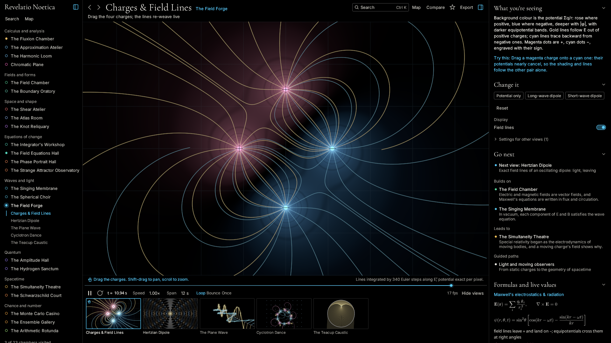
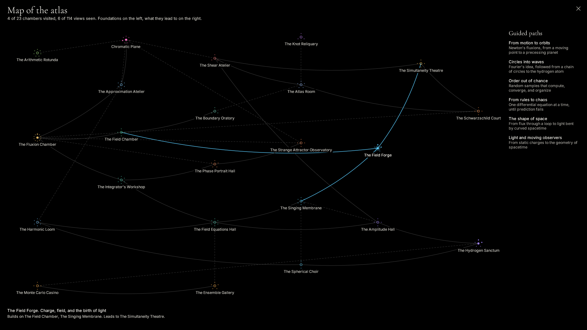

# Revelatio Noetica

*A Living Atlas of Mathematics and Natural Philosophy*

A GPU-first desktop atlas of advanced mathematics and theoretical physics, built
with technical honesty: a native Rust + wgpu renderer, 23 chambers holding 114 live
views, and exact mathematics wherever exact mathematics is possible.

Not a graphing calculator. Not an animation toy. Every view says what it computes
and how it approximates.



## Build and run on Linux

You need [Rust](https://rustup.rs), a Vulkan driver, and the usual windowing headers.

```sh
# Fedora
sudo dnf install vulkan-loader-devel libxkbcommon-devel wayland-devel \
    libX11-devel libXcursor-devel libXi-devel libXrandr-devel

# Debian, Ubuntu
sudo apt install libvulkan-dev libxkbcommon-dev libwayland-dev \
    libx11-dev libxcursor-dev libxi-dev libxrandr-dev

cargo build --release
./target/release/revelatio
```

To add it to your application menu, run `scripts/install-desktop.sh`. It builds in
release mode and installs the binary, icon, and menu entry under `~/.local`, and
registers `revelatio:` scene links. It will not overwrite an existing
`~/.local/bin/revelatio` it did not install. `scripts/install-desktop.sh --uninstall`
removes only what the install recorded, and only if unchanged, and leaves your session
and exports alone.

The project was first built on Windows and still should be, with
`cargo build --release`, though Linux is what is tested now.

## Finding your way around

The window is one black field, with the visual as the largest thing in it.

- **Above the visual**: the view's name, the chamber it belongs to, and one line on
  what it shows, with search, the map, compare, save, and export to the right.
- **Below the visual**: how to work it, the honest label of how it is computed, the
  time line, and a filmstrip of every view in the chamber as small live renders.
- **Right panel**: what you are seeing and how to read it, a suggestion to try, the
  parameters that change this view, and where to go next. Formulas and live values
  and the chamber's background follow. Drag its edge to resize it.
- **Left**: the atlas, by shelf. Folded, it is a rail of one lit point per chamber:
  filled once visited, ringed until then.



## Ways to explore

- **Search** (`Ctrl K`): every chamber, view, preset, guided path, saved view, and
  action, matched on names, explanations, control labels, and choices. Accents are
  optional: `schrodinger` and `rossler` both work.
- **Map** (`M`): the chambers as a chart, foundations on the left. Solid lines are
  prerequisites, dashed lines parallels, each with its reason in the side panel. The
  points around a star are its views, lit as you see them.
- **Guided paths**: six walks across chambers, each step saying why it follows the
  last. Start one from the map, the panel, or search; `N` and `P` step through.
- **Compare** (`C`): any view beside any other, across chambers, on a shared clock. A
  second view splits the stage evenly; with three or four, one is the hero. The `+` on
  a thumbnail, or `Ctrl`-click, adds a view directly.
- **Presets**: named settings per chamber, real ones where they exist, such as Lorenz's
  1963 parameters or the critical Ising temperature.
- **Randomize** (`R`) and **Reset**: new values for this view's sliders and choices.
- **Sweep**: the wave button beside a slider runs it back and forth across its range.
- **Direct manipulation**: views you can touch show a hand, in the filmstrip and
  under the canvas, with the gesture spelled out. Strike the membrane, drag charges and
  spacetime events, sculpt a matrix by its basis vectors, paint Ising spins, thread
  solutions through a slope field, fire measurement bursts. Search for `hands-on` to list them.
- **Saved views** (`B`) and **back and forward** (`Alt+Left`, `Alt+Right`). Your place,
  saved views, and which views you have seen persist between runs.
- **Scene links**: Export, then Copy link. Paste it into any window with `Ctrl V`, or
  pass it on the command line. A scene holds the open views, cameras, time, parameters,
  and dragged charges and events. It does not hold running simulation state, so painted
  spins, struck waves, and threaded curves are not carried.

Press `?` in the app for every shortcut. `F` hides everything but the visual, and its
honesty label.

Sessions live in `$XDG_CONFIG_HOME/revelatio-noetica/session.json`, by default under
`~/.config`. Window exports go to `~/Pictures/Revelatio Noetica`, or to
`$REVELATIO_EXPORT_DIR` if set.

## Command line

No window is needed for any of these except the first two, which is how CI checks exports.

```
revelatio                                               # open the atlas
revelatio <file.scene.json | revelatio:scene?...>       # open at a scene
revelatio --list                                        # chambers and views
revelatio --export <id|all> [--mode N] [--size WxH] [--t sec] [--out dir]
revelatio --frames <id> [--mode N] [--n 150] [--fps 30] [--out dir]
revelatio --scene <file.scene.json> [--size WxH] [--out png]
```

On a machine without a GPU, Mesa's lavapipe works: set
`VK_ICD_FILENAMES=/usr/share/vulkan/icd.d/lvp_icd.x86_64.json WGPU_BACKEND=vulkan`.

## Typeset mathematics

Formulas in the panel are genuine LaTeX. `assets/math/manifest.txt` holds the sources,
and `tools/render_math.sh` renders them with `pdflatex` and `pdftocairo` into
white-on-transparent PNGs and regenerates `src/mathimg_gen.rs`, which bakes them into
the binary. Run it after editing the manifest; its header lists the packages it needs.
`tools/render_math.ps1` is the Windows equivalent, through MiKTeX, and has not been run
since the Linux script was added. The app uses only each image's alpha, tinted to the
text colour. Live numeric values stay as text.

## The 23 chambers and 114 views

| Shelf | Chamber | Views |
|---|---|---|
| Calculus and analysis | **The Fluxion Chamber** | Fluent Generation, Fluxion Vectors, Moment Pulse, Inverse Fluxion, Newton · Leibniz, Principia Motion, Generation of Solids, Fluxion Cathedral, Brachistochrone Race, Tautochrone Chorus |
| Calculus and analysis | **The Approximation Atelier** | Taylor Stage, Newton Fractal, The Microscope, The Euler Spiral, The Chaos Game, The Hilbert Curve |
| Calculus and analysis | **The Harmonic Loom** | Epicycle Loom, Harmonic Stack, Amplitude Spectrum, Gibbs Lens, Lissajous Chamber, The Drawing Machine |
| Calculus and analysis | **Chromatic Plane** | Domain Coloring, Analytic Landscape, Conformal Grid Flow, Riemann Sphere, Julia Frontier, Mandelbrot Atlas, Möbius Ballet |
| Fields and forms | **The Field Chamber** | Field & Flow, Divergence · Curl Heat, Flux & Circulation Probe, Streamline Weave |
| Fields and forms | **The Boundary Oratory** | Surface & Boundary, Telescoping Cells, 1-Form as Level Stack |
| Space and shape | **The Shear Atelier** | Grid Deformation, Eigen-directions, SVD Stage |
| Space and shape | **The Atlas Room** | Tangent Space, Parallel Transport, Gaussian Curvature, The Poincaré Disk, Voronoi Bloom |
| Space and shape | **The Knot Reliquary** | Tube Gallery, Crossing Diagram, The Winding Loom |
| Equations of change | **The Integrator's Workshop** | Slope Field, Euler vs Runge–Kutta, Van der Pol Cycle, Predator & Prey, Resonance, The SIR Epidemic |
| Equations of change | **The Field Equations Hall** | The Cooling Rod, Laplace Equilibrium, Burgers Shock, String Eigenmodes, Gray–Scott Garden, Spiral Hearts |
| Equations of change | **The Phase Portrait Hall** | Phase Portrait, The Swing, Energy Landscape, Double-Pendulum Fan, The Infinite Pendulum Wave |
| Equations of change | **The Strange Attractor Observatory** | Particle Swarm, Twin Trajectories, Logistic Bifurcation, The Figure-Eight Waltz |
| Waves and light | **The Singing Membrane** | Amplitude Field, Standing Relief, Energy Density, Wavefronts, Chladni Figure, Doppler Wake |
| Waves and light | **The Spherical Choir** | Breathing Mode, Nodal Atlas |
| Waves and light | **The Field Forge** | Charges & Field Lines, Hertzian Dipole, The Plane Wave, Cyclotron Dance, The Teacup Caustic |
| Quantum | **The Amplitude Hall** | Wavefunction, Probability River, Phase Clocks, Measurement Rain |
| Quantum | **The Hydrogen Sanctum** | Amplitude Cloud, Electron Cloud (Trembling), Nodal Chambers, Radial Distribution, Born Accumulation |
| Spacetime | **The Simultaneity Theatre** | Minkowski Diagram, Light Clock & Rod, Boosted Coulomb Field, The Twin Wager |
| Spacetime | **The Schwarzschild Court** | Gravitational Lensing, Precessing Geodesic, Effective Potential, Flamm's Paraboloid |
| Chance and number | **The Monte Carlo Casino** | Dartboard π, Buffon's Needle, Integration by Rain, The Galton Board |
| Chance and number | **The Ensemble Gallery** | Ising Lattice, Gas in a Box, The Drunkard's Cloud, Percolation Threshold, Conway's Colony |
| Chance and number | **The Arithmetic Rotunda** | Ulam Spiral, Modular Strings, Zeta Walk, The Prime Staircase, Phyllotaxis, Collatz Coral, The Prime Galaxy |

## Architecture

```
src/
  main.rs        CLI and GUI dispatch
  app/           the shell: panes, navigator, side panel, dock, palette, map
  atlas/         the atlas as data: shelves, links, guided paths, guides, presets, search
  session.rs     what persists between runs, and scene links
  theme.rs       true black, three text brightnesses, one light per branch
  widgets.rs     quiet buttons, chips, sliders, vector icons
  engine/
    gpu.rs       GpuContext and offscreen ViewTargets (MSAA 4x, readback)
    draw.rs      shared luminous renderers: lines, points, meshes, field shaders
    mesh.rs      parametric surfaces, parallel-transport tubes
    camera.rs    plane and orbit observer frames
    module.rs    the ConceptModule plugin trait and the Engine host
    params.rs    typed, serializable parameter sets
    timeline.rs  the generating time
    export.rs    PNG stills, frame sequences, scene files
  modules/       one file per concept family (the plugins)
shaders/         shared WGSL: complex arithmetic, OKLab phase wheel,
                 viridis/inferno/aurum, camera rays, grid engraving
```

A chamber implements one trait: metadata, parameter schema, views (each with its own
camera kind), GPU init, per-frame `update` where solvers live, per-view `render` that
fills a scene of luminous primitives, a symbolic inspector, honest approximation
labels, and optional canvas annotations. The engine owns the shared pipelines; modules
describe, the engine draws. The canvas and every export render through the same path,
so what you see is what you export.

`cargo test` checks the atlas against the real modules: every view has a guide, every
link and path names real views, prerequisites run left to right on the map, every
preset is in range. With any Vulkan driver, lavapipe included, it also renders all
114 views and fails if a view has no `#000000` pixel, apart from three whose data
fills the canvas. Physics tests check results against known values, such as the exact
mean radius of hydrogen states and field lines of the Hertzian dipole.

## Technical honesty

- Exact where possible: closed-form eigenstates, Kepler solutions, hydrogen
  wavefunctions, 2×2 SVD, Fourier coefficients, Lorentz geometry, field-line angles of
  the boosted charge.
- Numerical where necessary, and labeled: each view states its method under the canvas,
  such as the FDTD lattice, RK4 with displayed energy drift, quadrature step counts, and
  the known error of the lensing integrator.
- No planetary electrons. Quantum states are amplitudes: density, phase, nodes, and
  measurement statistics.

## Fonts and licence

The code is under the MIT License; see `LICENSE`. Cormorant Garamond, Inter, and Noto
Sans Math are embedded from `assets/fonts/` under the SIL Open Font License 1.1; see
`NOTICE` and `assets/fonts/OFL.txt`.
